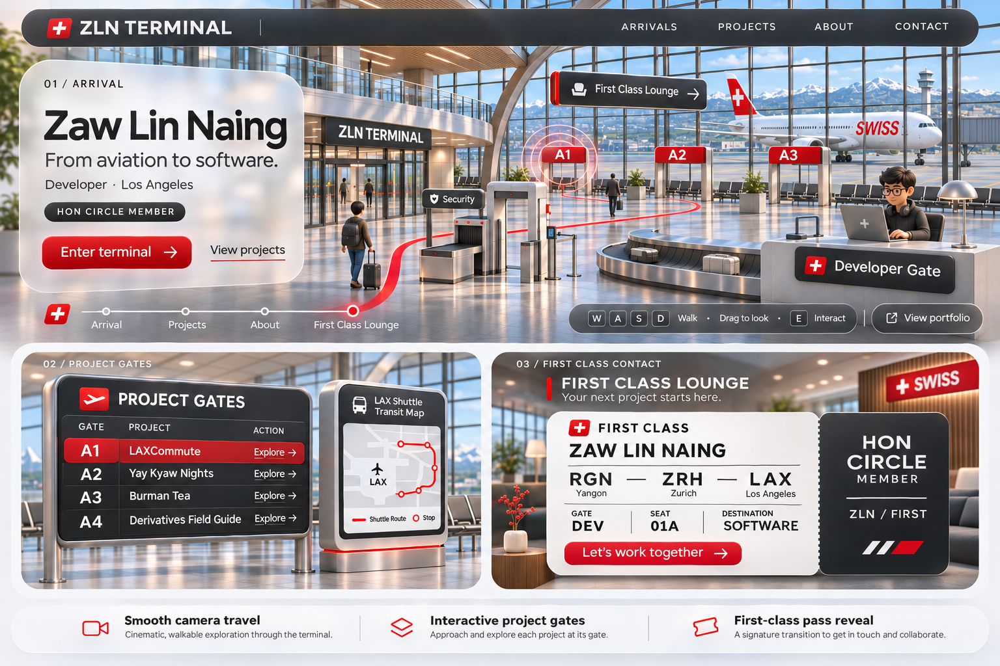
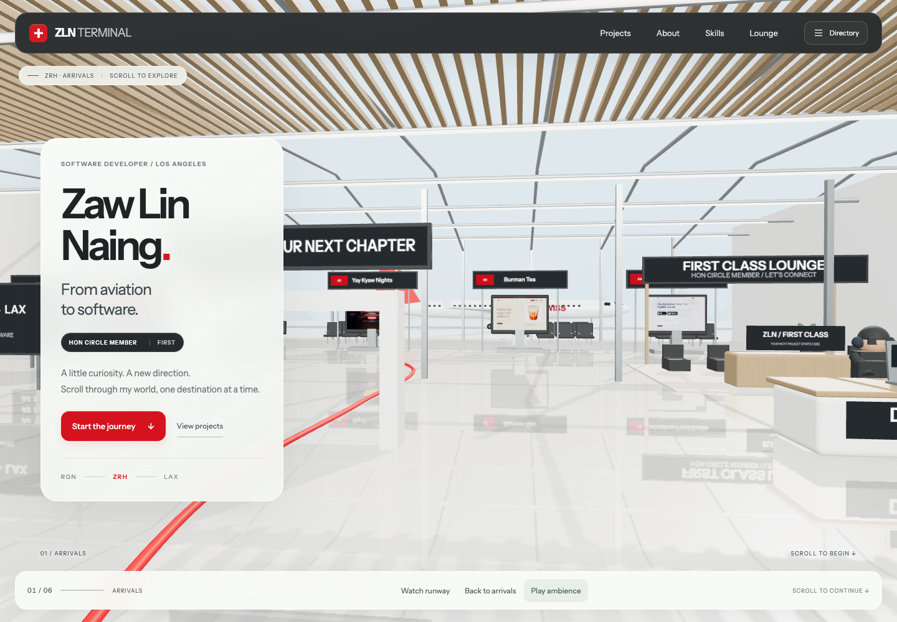

# ZLN Terminal

**Zaw Lin Naing’s developer portfolio — from aviation to software.**

[Live portfolio](https://normanlinn.github.io/) · [GitHub](https://github.com/normanlinn) · [Email](mailto:mrzawlinnaing1001@gmail.com)

## Two versions, one journey

| Version | Where to find it |
| --- | --- |
| Current published 3D portfolio | [normanlinn.github.io](https://normanlinn.github.io/) |
| Preserved version before the 3D redesign | [`archive/pre-airport-3d-20261119`](https://github.com/normanlinn/normanlinn.github.io/tree/archive/pre-airport-3d-20261119) |
| Earlier walkable prototype | [`feature/swiss-airport-3d`](https://github.com/normanlinn/normanlinn.github.io/tree/feature/swiss-airport-3d/airport) |

The published portfolio is a scroll-guided **Three.js + TypeScript** airport experience. The previous editorial version is preserved on the archive branch.

## Explore the terminal

- **Arrivals:** enter a 3D terminal with a red floor route and an aircraft beyond the windows.
- **Gates E42–E45:** open real developer projects from the gate screens or departures board.
- **Developer desk:** explore my tools and technologies.
- **Developer pass:** read about my path from aviation customer service at LAX to building software.
- **First Class Lounge:** open a boarding-pass contact panel, copy my email, or view my résumé.

The terminal now draws on Zürich Dock E: exposed concrete soffits, a central skylight, terrazzo, bilingual yellow wayfinding, apron jet bridges, and a control tower. Four layers of textured Swiss ridges, snowfields and evergreen foothills sit beyond the airport.

The runway fleet includes the licensed A350 and an original procedural **777-300ER interpretation**, with a longer fuselage, raked wingtips, large twin engines and fourteen wheels. Select either aircraft for landing and takeoff. The A350 has replacement tapered tailplanes. Both include animated fans and retracting gear; moving luggage, opening doors, environment-lit terrazzo and the pause control remain part of the scroll journey.

### Controls

| Action | Desktop | Touch |
| --- | --- | --- |
| Travel through the terminal | Scroll wheel, trackpad, Page Down / Page Up | Swipe vertically |
| Jump to a destination | Top navigation | Top navigation |
| Open a project | Project gate buttons, directory, or a visible 3D screen | Tap the same buttons or screens |
| Open contact details | First Class Lounge boarding-pass button | Tap the boarding-pass button |
| Close a panel | Escape or close button | Close button |
| Choose an aircraft | Watch runway, then A350 or 777-300ER | Same controls |
| See aircraft sequences | Landing or Takeoff | Same controls |
| Inspect the aircraft | Watch runway enables drag-to-look; Reset view restores the view | Drag in Explore view; Resume scroll view restores swiping |

The main journey is **scroll-guided** with no walking keys, joystick or pointer lock. Runway Explore view provides a bounded drag-to-look camera; the main journey remains available through navigation or scroll. The camera follows a curated route between Arrivals, Projects, My Story, Developer Desk, First Class Lounge, and Runway Observation.

Reduced-motion mode uses static camera cuts between destinations. Ambient luggage, route lights, and engine movement can be paused. Selecting a flight explicitly starts that aircraft sequence; Pause ambience pauses it too.

## Run the 3D portfolio

Tested with Node.js 24. From the repository root:

```sh
npm --prefix airport ci
npm run airport:build
npm run airport:dev
```

Open **[http://127.0.0.1:4180](http://127.0.0.1:4180)**. The build checks TypeScript and creates the standalone static site in `airport/dist/`. Serve that folder over HTTP; opening the HTML directly as a local file is not supported.

### Run checks

```sh
npm --prefix airport test
```

With the preview server running, install a Playwright browser once and run the browser checks:

```sh
cd airport
npx playwright install chromium
npm run test:browser
```

Set `CHROME_PATH` to use an already installed Chrome executable.

## Publish

The existing GitHub Pages workflow deploys the committed `docs/` folder. After changing the airport source, install its locked dependencies, run the tests and production build, then commit the generated `airport/dist/`, `dist/`, and `docs/` files before pushing main.

```sh
npm run build
```

The build preserves the Google Search Console verification file, sitemap, résumé, and search metadata.

## Source map

| Path | Purpose |
| --- | --- |
| `airport/src/materials.ts` | Local stone/wood textures and environmental lighting |
| `airport/src/aircraft.ts`, `airport/src/flight.ts` | Smooth aircraft geometry and deterministic landing/takeoff paths |
| `airport/src/main.ts` | Scene geometry, lighting, scroll-linked camera route, project interactions, and panels |
| `airport/index.html` | Arrival UI, navigation, directory, and accessible fallback links |
| `airport/site.css` | Responsive typography, rounded interface, panels, and transitions |
| `airport/build.mjs` | Bundles `src/` and copies `index.html`, `site.css`, `assets/` and `public/` into `airport/dist/` |
| `airport/assets/` | Fonts, project screenshots, portrait, résumé, aircraft model and QR codes |
| `airport/public/` | Files served from the site root: `llms.txt`, `sitemap.xml`, Search Console verification |
| `airport/design/` | Visual concept and prototype screenshots |
| `dist/`, `docs/` | Generated production site (rebuilt from scratch by `npm run build`; do not edit by hand) |
| `scripts/publish-airport.mjs` | Prepare the production GitHub Pages folder |

The earlier editorial version of the site lives on the [`archive/pre-airport-3d-20261119`](https://github.com/normanlinn/normanlinn.github.io/tree/archive/pre-airport-3d-20261119) branch.

Run `npm --prefix airport run format` to format the source with Prettier before committing.

## Real projects

| Gate | Project | Live site |
| --- | --- | --- |
| A1 | LAXCommute | [employeeshuttlelax.com](https://employeeshuttlelax.com/) |
| A2 | Yay Kyaw Nights | [yaykyawfair.vercel.app](https://yaykyawfair.vercel.app/) |
| A3 | Burman Tea | [burmantea.vercel.app](https://burmantea.vercel.app/) |
| A4 | Derivatives Field Guide | [normanlinn.github.io/calculus-study-site](https://normanlinn.github.io/calculus-study-site/) |

## Visual direction

The concept uses Swiss-inspired typography, white and charcoal surfaces, precise red wayfinding, and a first-class boarding-pass treatment. The aircraft and HON CIRCLE styling are part of the requested personal concept; this is a developer portfolio, not an airline booking service.

The image below is **art direction**, while the scroll prototype uses custom terminal geometry and a licensed A350 model. Matching the concept’s detailed architectural materials and character models is a later art pass.



### Current portfolio screenshot



## Validation

- TypeScript check and production bundle.
- Browser checks for WebGL rendering, scroll-led camera movement, destination navigation, project links, copy-email feedback, and phone layout.
- Reduced-motion mode, optional ambient animation, and an accessible destination directory.

## Ownership

Built and maintained by **[normanlinn — Zaw Lin Naing](https://github.com/normanlinn)**.

## Aircraft asset credit

The A350 base model is © 2026 **[amvlab](https://github.com/amvlab/aircraft-models)**, used under **[CC BY 4.0](https://creativecommons.org/licenses/by/4.0/)**. This version normalizes its geometry, adapts the livery to the requested SWISS-inspired design, separates engine fan geometry, and adds retractable landing gear. The asset credit and original license ship with the site in `airport/assets/`.

### Zürich-inspired terminal update

The airport is an original portfolio layout inspired by [Dock E’s concrete, metal, terrazzo and glass](https://www.flughafen-zuerich.ch/en/company/flughafen-zuerich/airport-development/old-conctruction-projects/dock-e), rather than a measured reconstruction. All landscape and surface textures are generated locally; no texture-service requests are required. The 777 geometry is original and separate from the licensed A350 base asset.

### Interface and aircraft refinements

The active section card stays between the fixed header and footer, with internal scrolling for long content. Navigation uses a moving Swiss-red marker and outline icons, while the favicon, wing monogram and social preview share the ZLN identity. Card fades, an animated code editor, restrained avatar motion and damped gear movement respect the ambient pause and reduced-motion controls. The 777 fuselage now uses shaped elliptical sections, skin-mounted windows and projected cockpit/door details.

### Boarding passes and rendering performance

The First Class contact panel offers paper and mobile layouts, each with selectable QR codes for GitHub and the résumé PDF. The QR assets are generated locally and verified by decoding both source PNGs and rendered browser images. They make no external QR-service requests.

The scene uses one main rendering pass, cached static shadows, limited shadow updates during flights, and on-demand drawing when the scene is paused. The code-editor texture updates only near the developer desk. Button feedback uses short transform/opacity animations with reduced-motion support. The 777 now has a monotone-smoothed radome, a swept thin fin, and airfoil-shaped horizontal stabilizers with trailing-edge elevator seams.
